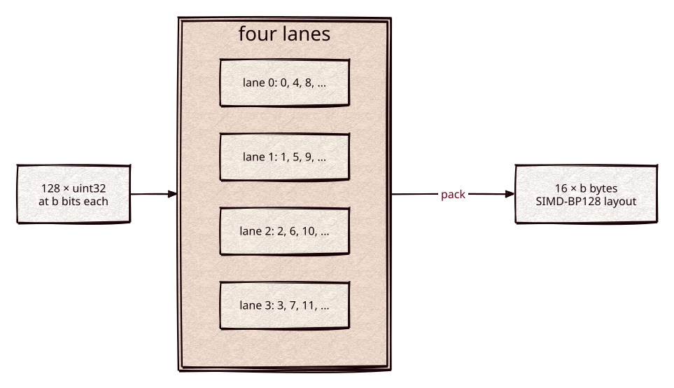

# bitpack

Part of [Kronuz C++ Libraries](https://github.com/Kronuz/cpp-libraries), a collection of small, reusable C++ libraries.

[](https://github.com/Kronuz/bitpack/actions/workflows/ci.yml)
[](LICENSE)


Bit packing for blocks of 128 unsigned 32-bit integers, for C++20, decoding at
SIMD-BP128 speed. It is the integer codec under search-engine postings: doc-id
deltas, term frequencies, and positions.



## ✨ Highlights

One header, `bitpack.hh`:

- `pack` / `unpack` a block of 128 integers at a fixed bit width (0 to 32). A block
  at width `b` takes exactly `16 * b` bytes.
- `unpack_delta` decodes 128 deltas and prefix-sums them onto a base in the same
  pass, which is how sorted doc ids come back.
- `encode_for`, `encode_pfor`, and `decode`: block codecs with a one-byte header.
  FOR packs every value at the block's maximum width. PFOR picks the width that
  minimizes the encoded size and stores the few larger values as exceptions. A
  block whose values are all equal (for example, all frequencies 1) encodes in
  5 bytes.
- `encoded_size` reads an encoded block's size from its headers without decoding
  it, for stepping over blocks laid out back to back.

SSE2 on x86-64 and NEON on AArch64 decode four integers per instruction; a portable
path covers everything else. All three read and write the same bytes.

## 📦 Installation

Requires a C++20 compiler and a little-endian host (x86-64 or AArch64); CMake 3.14
or newer for the CMake route. CI builds it on Linux (x86_64, arm64), macOS (arm64,
x86_64), and FreeBSD, plus ASan, UBSan, and TSan builds.

```cmake
include(FetchContent)
FetchContent_Declare(bitpack
  GIT_REPOSITORY https://github.com/Kronuz/bitpack.git
  GIT_TAG        main)
FetchContent_MakeAvailable(bitpack)

target_link_libraries(my_app PRIVATE bitpack::bitpack)
```

## 🚀 Quick start

```cpp
#include "bitpack.hh"

std::uint32_t ids[128] = { /* increasing doc ids */ };
std::uint32_t deltas[128];
bitpack::delta_encode(/*base*/ 0, ids, deltas);

std::uint8_t buf[bitpack::max_encoded_bytes];
std::size_t size = bitpack::encode_pfor(deltas, buf);   // header + packed bits (+ exceptions)

std::uint32_t back[128];
bitpack::decode_delta(buf, size, /*base*/ 0, back);      // back == ids; 0 if malformed
```

Fixed-width calls skip the header:

```cpp
unsigned bits = bitpack::max_bits(deltas);
std::uint8_t packed[bitpack::packed_bytes(32)];
bitpack::pack(deltas, bits, packed);
bitpack::unpack_delta(packed, bits, 0, back);
```

## 🧩 Layout

Integer `j` lives in lane `j % 4`, row `j / 4`. Each lane packs its 32 rows into
`b` 32-bit words, and word `w` of the four lanes is 128-bit word `w`. One 4-lane
register therefore decodes integers `4r .. 4r+3` in order, and the delta prefix sum
runs in the register. The bytes are identical to Lemire's SIMD-BP128 layout; the
benchmark checks this at every width.

## ⚡ Performance

Decoding, in integers per nanosecond, with cache-resident blocks (`bench/bench.cc`, the
best of two runs, Apple clang `-O3`). Both hosts are shared with other work, so absolute
numbers are indicative; each row compares the codecs in the same run.

Apple M4 Pro (NEON), against lemire/simdcomp:

| Bits | `unpack` | `unpack_delta` | Scalar | simdcomp | simdcomp/D1 |
|---:|---:|---:|---:|---:|---:|
| 1 | 27.46 | 3.44 | 6.46 | 25.84 | 3.39 |
| 4 | 23.81 | 3.43 | 3.81 | 24.25 | 3.40 |
| 8 | 21.23 | 3.43 | 3.14 | 21.22 | 3.42 |
| 12 | 19.73 | 3.39 | 2.01 | 19.54 | 3.40 |
| 16 | 17.39 | 3.47 | 3.13 | 17.56 | 3.42 |
| 20 | 15.51 | 3.41 | 1.77 | 16.63 | 3.38 |
| 24 | 15.08 | 3.43 | 1.84 | 14.23 | 3.42 |
| 32 | 21.25 | 3.44 | 5.49 | 12.97 | 12.80 |

Intel i9-9980HK (SSE2), against lemire's SIMD-BP128:

| Bits | `unpack` | `unpack_delta` | Scalar | SIMD-BP128 | SIMD-BP128/D1 |
|---:|---:|---:|---:|---:|---:|
| 1 | 9.86 | 5.11 | 3.62 | 9.85 | 5.12 |
| 4 | 9.66 | 5.13 | 1.61 | 9.65 | 4.64 |
| 8 | 9.13 | 4.64 | 1.39 | 9.30 | 4.65 |
| 12 | 8.92 | 4.91 | 0.97 | 8.93 | 4.79 |
| 16 | 8.79 | 4.70 | 3.51 | 8.85 | 4.68 |
| 20 | 8.45 | 4.78 | 0.90 | 8.87 | 4.09 |
| 24 | 8.26 | 4.66 | 0.86 | 8.47 | 4.59 |
| 32 | 8.21 | 5.37 | 3.37 | 10.73 | 8.05 |

Over widths 1 to 31, `unpack` averages 1.00× simdcomp and `unpack_delta` 1.01× its D1
decoder on the M4 Pro; on the i9 `unpack` averages 0.99× SIMD-BP128 and `unpack_delta`
1.03×. `unpack_delta` is bound by its carry chain (3.4 integers per ns on the M4 Pro at
every width). Width 32 is a copy: NEON `unpack` uses `memcpy`, the SSE2 kernel copies
row by row (0.77× SIMD-BP128), and simdcomp's D1 decoder at width 32 copies without
adding the base, so its figure there is not comparable. Reproduce with:

```sh
cmake -S . -B build -DCMAKE_BUILD_TYPE=Release -DBITPACK_BENCH_REFERENCE=ON
cmake --build build && build/bitpack_bench
```

`BITPACK_BENCH_REFERENCE` fetches lemire/simdcomp (BSD-3) on AArch64 and
lemire/SIMDCompressionAndIntersection (Apache-2.0) on x86-64, for the benchmark only; the
library never links them. `-DFETCHCONTENT_SOURCE_DIR_SIMDCOMP_REF=<dir>` uses a local
simdcomp on AArch64.

## 🛠️ Building and testing

```sh
cmake -S . -B build && cmake --build build && ctest --test-dir build
```

The tests round-trip every width at every position, require SIMD and scalar output
to be byte-identical, and exercise FOR, PFOR, constant blocks, and delta decoding.
`bitpack_portable_test` builds with `BITPACK_NO_SIMD` to cover the portable path.
`bitpack_differential` compares `pack`, `unpack` and `unpack_delta` with a frozen copy of the
previous kernels (`test/bitpack_v0.hh`) at every width, in the SIMD and portable builds.
`bench/asm_count.py` counts the input loads of each unpack kernel in the generated assembly.

## 🎯 When to use it

- ✅ Postings, id lists, and other runs of small integers, decoded in hot loops.
- ❌ Big-endian hosts, or variable-length tails; see the limits below.

### Limits

- Little-endian hosts only (x86-64, AArch64): the on-disk words are little-endian.
- Blocks are exactly 128 integers. Shorter tails belong to a variable-length
  integer codec such as [varint](https://github.com/Kronuz/varint).

## 📚 Documentation

- [ARCHITECTURE.md](ARCHITECTURE.md): the layout, the SIMD paths, and the codecs.
- [AGENTS.md](AGENTS.md): repository map and invariants.
- [CHANGELOG.md](CHANGELOG.md): what changed, with the timings.

## 🤝 Contributing

Issues and pull requests are welcome. The encoded bytes are a storage format and
must not change; read [AGENTS.md](AGENTS.md) first. CI must pass on every
platform.

## 📄 License

MIT, Copyright (c) 2026 Germán Méndez Bravo. See [LICENSE](LICENSE).
